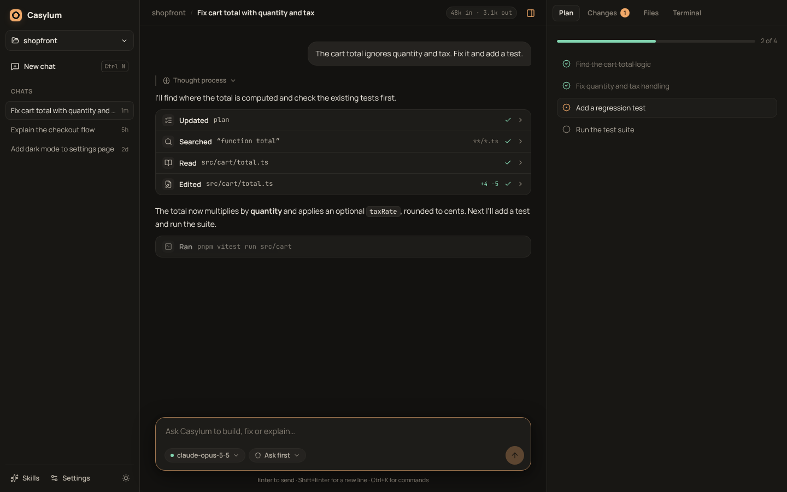

# Casylum

A calm, fast desktop AI coding agent. Bring your own API keys, open a folder, and ask for anything: Casylum reads your code, plans, makes edits you can review, and runs commands.



## Why it feels fast

- **Tauri 2 + Rust core.** Uses the system webview, so the app is small and light on memory. The agent loop, model streaming, file search, edits and the terminal all run in Rust.
- **Lean UI.** React with CodeMirror 6 (not Monaco) for code and diffs, xterm.js for the terminal, and off-screen chat messages skip rendering.

## Features

- **Bring your own keys:** Anthropic, OpenAI, Google Gemini, OpenRouter, Ollama (local) and any OpenAI-compatible endpoint. Keys live in your OS keychain (macOS Keychain, Windows Credential Manager, Secret Service on Linux) and never reach the UI layer.
- **Agent with real tools:** read, list, search (ripgrep engine), edit and create files, run commands, keep a live plan, load skills.
- **You stay in control:** three permission modes (Ask first, Auto-edit, Full auto), inline approve or deny with a preview of the exact diff or command, a Stop button that leaves the conversation in a clean state, and **Undo this run** to restore every file the agent touched.
- **Calm workspace:** tidy step cards instead of log walls, a side panel for Plan, Changes (diffs), Files and Terminal, a command palette (`Ctrl/Cmd+K`), dark and light themes.
- **Skills:** folders with a `SKILL.md` (name + description frontmatter), compatible with Claude Code-style skills. Only descriptions go into the prompt; the agent loads a skill's full instructions when a task needs it. Manage them in the Skills panel.
  - Global: `~/.casylum/skills/<name>/SKILL.md`
  - Per project: `<project>/.casylum/skills/<name>/SKILL.md`
- **Project instructions:** a `CASYLUM.md`, `AGENTS.md` or `CLAUDE.md` at the project root is added to the agent's instructions.
- **Chats persist** per project in the app's config folder.

## Develop

Prerequisites: Node 20+, pnpm, Rust (stable), and the [Tauri system dependencies](https://tauri.app/start/prerequisites/) for your OS.

```bash
pnpm install
pnpm tauri dev        # run the desktop app
pnpm tauri build      # make an installer for your OS
```

UI-only work in a normal browser: `pnpm dev` and open http://localhost:1420. Outside Tauri the app uses a mock core (`src/dev/mock.ts`) with a sample conversation. Add `?theme=light` or `?onboard=1` to the URL to preview those states.

Tests: `cargo test --manifest-path src-tauri/Cargo.toml` covers path sandboxing, edits and undo, commands, skill parsing, and streaming for the Anthropic and OpenAI-compatible adapters.

## Layout

```
src-tauri/src/
  agent.rs        agent loop, approvals, sessions, undo checkpoints
  providers/      anthropic.rs, openai.rs (also OpenRouter/Ollama/custom), gemini.rs, SSE reader
  tools.rs        read/list/search/write/edit/run/plan/skill tools, sandboxed to the project
  skills.rs       skill discovery, loading and editing
  keys.rs         OS keychain storage
  terminal.rs     PTY-backed terminal
  settings.rs     non-secret settings
src/
  components/     Rail, Chat, StepCard, Composer, ContextPanel, Settings, Skills, Palette, Onboarding
  store.ts        app state and agent event handling
  lib/            typed IPC bridge, editor theme, step helpers
```

## License

Apache 2.0
